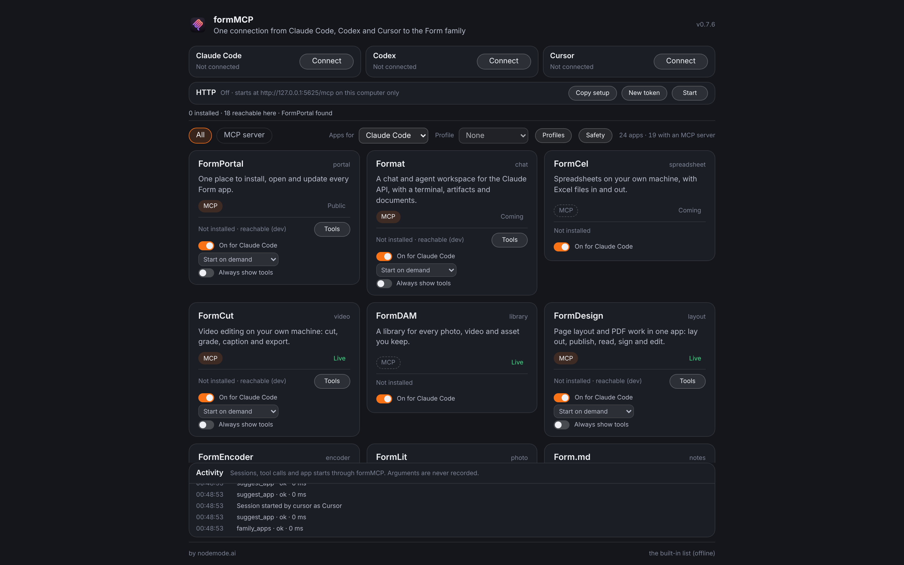
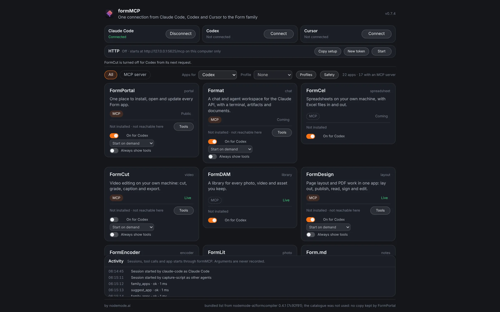
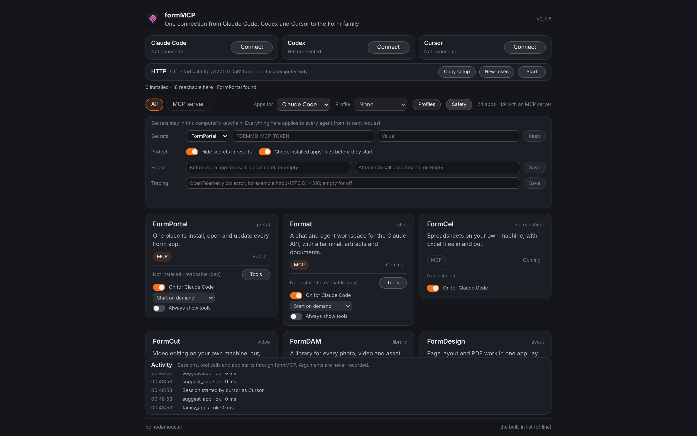

<p align="center"></p>

<h1 align="center">FormMCP</h1>

<p align="center">
  <b>Agent gateway; one MCP connection from Claude Code, Codex and Cursor to the Form family.</b><br>
  Every Form app in one short list, an app's own tools loaded only when a task needs them,<br>
  and it never installs anything. Local, and yours.
</p>

<p align="center">
  
  
  
  
  
  
</p>

<p align="center">
  <a href="https://formmcp.formai.studio/"><b>Download FormMCP on formai.studio</b></a> ·
  <a href="#run-it-from-source">Run it from source</a>
</p>

<br>

<p align="center">
  
  <br><sub>The window: the Form family as agents see it, with a live log of the sessions and calls from three agents.</sub>
</p>

<p align="center">
  <a href="#features">Features</a> · <a href="#everything-in-the-box">In the box</a> · <a href="#built-for-agents">Agents</a> · <a href="#under-the-hood">Under the hood</a> · <a href="#download">Download</a> · <a href="#run-it-from-source">Run from source</a>
</p>

<br>

<table>
  <tr>
    <td width="25%" valign="top"><h3>Cheap on context</h3>One line per app and no app's tools, so the family list stays small instead of loading every app's tools up front.</td>
    <td width="25%" valign="top"><h3>You choose what each agent gets</h3>Turn an app or a single tool off for Claude Code, Codex or Cursor, and share the setup as a named profile.</td>
    <td width="25%" valign="top"><h3>Safe by default</h3>Secrets live in the system keychain, results are scrubbed, and an installed app whose files changed is refused.</td>
    <td width="25%" valign="top"><h3>Agent-ready</h3>The same engine runs the window, a command line and an MCP server over stdio or local HTTP.</td>
  </tr>
</table>

<br>

## Features

<table>
  <tr>
    <td width="50%" valign="top">
      
      <br><sub>Apps per agent: one app is turned off for Codex only.</sub>
      <h3>Per-agent control</h3>
      Off apps leave that agent's lists and are refused with the reason. Changes apply from the next request.
    </td>
    <td width="50%" valign="top">
      
      <br><sub>The Safety panel: secrets, hooks and tracing.</sub>
      <h3>Safety you can see</h3>
      Hooks can allow or refuse each call, and tracing sends names and outcomes, never arguments, to an OpenTelemetry collector.
    </td>
  </tr>
</table>

## Everything in the box

<table>
  <tr>
    <td width="33%" valign="top"><h4>8 MCP tools</h4>family_apps · suggest_app · app_tools · call_app · app_resources · read_app_resource · app_prompts · get_app_prompt</td>
    <td width="33%" valign="top"><h4>Controls</h4>Apps per agent · single tools · profiles · start policies · hooks · secrets · tracing · activity log</td>
    <td width="33%" valign="top"><h4>Transports</h4>stdio · local HTTP at <code>127.0.0.1:5625/mcp</code> with an access token · Claude Code, Codex and Cursor</td>
  </tr>
</table>

## Built for agents

FormMCP suggests; FormPortal installs. The agent sees one short list and loads one app's own tools on demand.

```sh
./formmcp cli apps                        # the family list as JSON
./formmcp cli reach                       # how each app's server would be started on this computer
./formmcp cli agents install              # add FormMCP to Claude Code, Codex and Cursor
./formmcp mcp                             # MCP server on stdio for Claude Code, Codex and Cursor
```

`.mcp.json`, `.codex/config.toml` and `.cursor/mcp.json` are already wired in this repo. See [`AGENTS.md`](AGENTS.md).

## Under the hood

- **Headless first:** the engine and the MCP server need no window, and the installed app answers `formmcp mcp` without opening one.
- **Family list:** the signed family catalogue over a list generated from formcompiler's registry, and every answer says which was used.
- **Pass-through:** `call_app` returns an app's own result unchanged, so the tools are always the running app's.
- **Window:** vanilla TypeScript and Vite with zero runtime dependencies, painted complete in its first frame.
- **Local only:** HTTP binds 127.0.0.1, checks Host and Origin, and needs a token on every request.
- **Tested:** 30 Rust tests (family list, catalogue keys, reach, the MCP server over stdio and HTTP).

## Download

| Platform | Download | Release |
|---|---|---|
| macOS | [Download FormMCP for macOS](https://formai.studio/get/formmcp/macos) | [FormMCP releases on FormCompiler](https://github.com/nodemode-dev/formcompiler/releases?q=formMCP-v&expanded=true) |
| Windows | [Download FormMCP for Windows](https://formai.studio/get/formmcp/windows) | [FormMCP releases on FormCompiler](https://github.com/nodemode-dev/formcompiler/releases?q=formMCP-v&expanded=true) |
| Linux | [Download FormMCP for Linux](https://formai.studio/get/formmcp/linux) | [FormMCP releases on FormCompiler](https://github.com/nodemode-dev/formcompiler/releases?q=formMCP-v&expanded=true) |

All FormMCP builds are compiled and released from [FormCompiler](https://github.com/nodemode-dev/formcompiler); this repo holds the source.

## Run it from source

Prefer it in your browser, or want to contribute? Run the web UI straight from this repo.

**Requires:** Rust stable, Node 20.19 or newer. On Linux, `libdbus-1-dev` and `pkg-config` for the keychain, and WebKitGTK 4.1 for the window.

```sh
git clone git@github.com:nodemode-dev/formMCP.git
cd formMCP
./formmcp_oc_install   # checks the tools and installs the window's packages
./formmcp              # the window at http://localhost:5620
```

On Windows run `formmcp_oc_install.bat`, then `formmcp.bat`. Form app checkouts in the folder beside this one are found on their own.

| Service | URL | Notes |
|---|---|---|
| Window (Vite) | http://localhost:5620 | localhost only; preview is on 5621 |
| MCP over HTTP | http://127.0.0.1:5625/mcp | while the window or `formmcp serve` runs; `FORMMCP_HTTP_PORT` changes it |

| Variable | Purpose |
|---|---|
| `FORMMCP_DEV_ROOTS` | Folders holding Form app checkouts (empty turns the search off) |
| `FORMMCP_CATALOG` | Catalogue address to read instead of the public store |
| `FORMMCP_HOME` | Where settings, the activity log and the access token are kept |

> [!IMPORTANT]
> **Status:** in development. In a plain browser the window shows the family list only; its live panels need the desktop shell. See [`.docs/wiki/Architecture.md`](.docs/wiki/Architecture.md).

**Contributing:** branch from `main`, keep changes to source here, and leave packaging and releases to formcompiler. See [`.docs/BRANCHING.md`](.docs/BRANCHING.md) and [`AGENTS.md`](AGENTS.md).

## Repository

| Path | What it is |
|---|---|
| `core/` | the engine: family list, reach, running apps, the MCP server and the safety parts |
| `cli/` | `formmcp-cli`, the command line and MCP server |
| `src-tauri/` | the Tauri 2 shell: the window, and `formmcp mcp` with no window |
| `frontend/` | the window: tokens, layers, one list |
| `setup/` | `family.py`, which generates the family list from formcompiler |

Docs: [`.docs/wiki`](.docs/wiki) · Agents: [`CLAUDE.md`](CLAUDE.md), [`AGENTS.md`](AGENTS.md)

---

## Maintainers

| Maintainer | Role |
|---|---|
| [@nodemode-ai](https://github.com/nodemode-ai) | Owner |
| [@gbarnai](https://github.com/gbarnai) | Co-owner |

Code owners are set in [`.github/CODEOWNERS`](.github/CODEOWNERS).

## License

FormMCP is licensed under the GNU General Public License v3.0 ([`LICENSE`](LICENSE), SPDX `GPL-3.0-only`). Copyright 2026 NodeAgentc, Inc. Third-party notices: [`NOTICE.md`](NOTICE.md).

<sub>Claude Code is a product of Anthropic, Codex of OpenAI and Cursor of Anysphere; they are named only as the agent clients FormMCP connects to. FormMCP is not affiliated with or endorsed by them.</sub>
